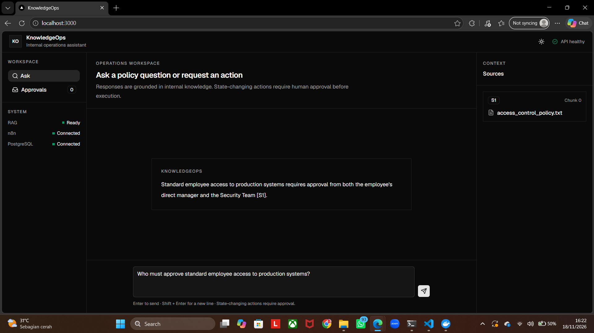
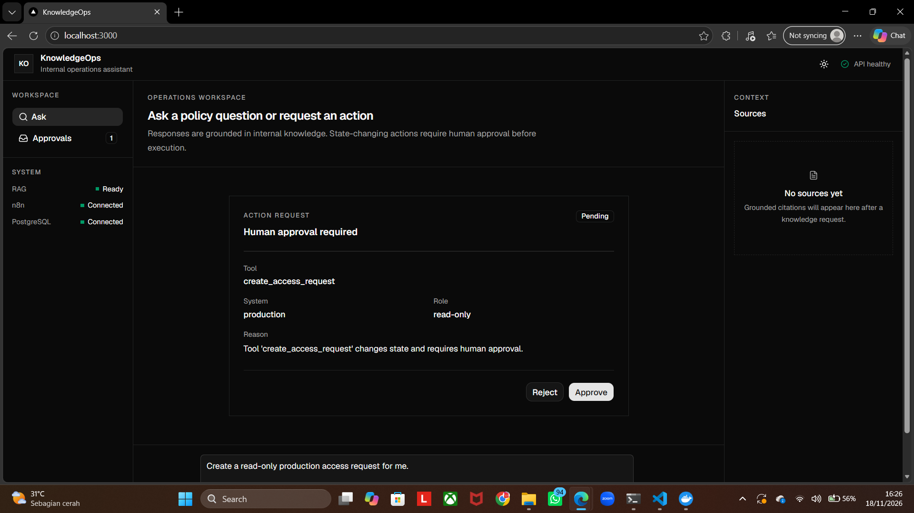
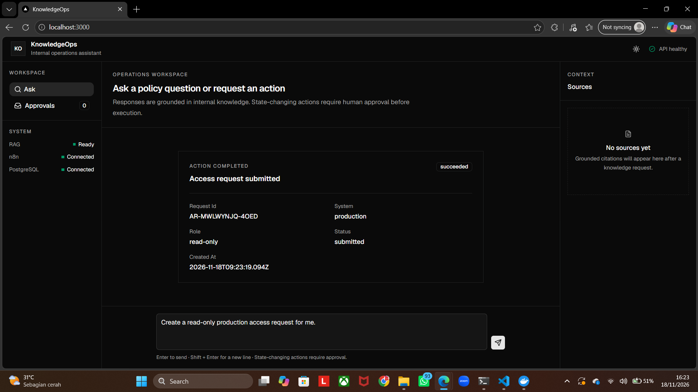

# KnowledgeOps AI

**Production-oriented RAG and AI agent system for internal business knowledge and workflow automation.**

KnowledgeOps AI combines grounded retrieval, source citations, safe AI-agent execution, human approval gates, workflow automation, and containerized deployment into a single internal operations assistant.

The project is designed to demonstrate how an AI system can do more than answer questions: it can retrieve trusted internal knowledge, decide when an operational action is required, pause before state-changing actions, request human approval, and execute approved workflows through n8n.

---

## Demo

### Grounded RAG Answer

The assistant retrieves relevant internal policy content and returns an answer with a visible citation to the supporting source.



### Human Approval Gate

State-changing actions are not executed immediately. The agent first produces a structured action request and waits for explicit human approval.



### Approved Action Execution

After approval, the backend resumes the agent workflow, executes the tool through n8n, and returns the resulting access-request record to the UI.



---

## Business Problem

Internal teams often need two different capabilities from an AI assistant:

1. **Knowledge access**
   Employees need fast answers from internal policies, procedures, and operational documents.

2. **Operational actions**
   Employees also want the assistant to perform actions such as submitting access requests or triggering business workflows.

A basic chatbot can answer questions, but allowing an LLM to execute operational actions directly introduces significant risk.

KnowledgeOps AI separates these responsibilities.

Knowledge requests use a grounded RAG pipeline with citations, while state-changing requests are routed through a controlled agent workflow with explicit human approval before execution.

---

## Key Features

- Retrieval-Augmented Generation for internal business knowledge
- Semantic retrieval using sentence-transformer embeddings
- PostgreSQL with pgvector vector storage
- Retrieval reranking
- Source-grounded responses with citations
- Abstention / fallback behavior for unsupported questions
- Gemini-based agent planning
- Structured tool calling
- Human-in-the-loop approval for state-changing actions
- Approval and rejection workflow
- n8n workflow automation
- FastAPI backend
- Next.js operations dashboard
- Dark and light theme support
- Dockerized backend and frontend
- Docker Compose orchestration
- Automatic n8n workflow bootstrap
- Database migration with Alembic
- Backend health checks
- Automated backend tests
- Production frontend build validation

---

## System Architecture

```text
                            ┌──────────────────────┐
                            │      Next.js UI      │
                            │   Operations Console │
                            └──────────┬───────────┘
                                       │
                                       ▼
                            ┌──────────────────────┐
                            │      FastAPI API     │
                            └──────────┬───────────┘
                                       │
                    ┌──────────────────┴──────────────────┐
                    │                                     │
                    ▼                                     ▼
          ┌───────────────────┐                 ┌────────────────────┐
          │     RAG Path      │                 │    Agent Path      │
          │                   │                 │                    │
          │ Embedding         │                 │ Gemini Planner     │
          │ Retrieval         │                 │ Tool Selection     │
          │ Reranking         │                 │ Approval Policy    │
          │ Grounding         │                 │ Human Approval     │
          │ Citation          │                 │ Tool Execution     │
          └─────────┬─────────┘                 └──────────┬─────────┘
                    │                                      │
                    ▼                                      ▼
          ┌───────────────────┐                 ┌────────────────────┐
          │ PostgreSQL        │                 │        n8n         │
          │ + pgvector        │                 │ Workflow Automation│
          └───────────────────┘                 └────────────────────┘
```

---

## RAG Pipeline

The knowledge path follows a multi-stage retrieval pipeline:

```text
User Question
    ↓
Query Embedding
    ↓
pgvector Similarity Search
    ↓
Candidate Retrieval
    ↓
Reranking
    ↓
Context Construction
    ↓
Grounded Generation
    ↓
Answer + Source Citation
```

The system is designed to avoid unsupported answers. If retrieved evidence is insufficient, the RAG layer can abstain rather than confidently generate an ungrounded response.

---

## Agent and Human Approval Flow

Operational actions use a separate path from normal knowledge requests.

```text
User Request
    ↓
Gemini Planner
    ↓
Agent Orchestrator
    ↓
Tool Selection
    ↓
Approval Policy
    ↓
Does the tool change state?
    │
    ├── No ──→ Execute
    │
    └── Yes
          ↓
    Human Approval Required
          ↓
      Approve / Reject
          │
          ├── Reject ──→ Stop
          │
          └── Approve
                  ↓
            Resume Agent
                  ↓
            Execute Tool
                  ↓
             n8n Workflow
                  ↓
              Result
```

The current example tool is:

```text
create_access_request
```

A request such as:

```text
Create a read-only production access request for me.
```

is converted into structured arguments:

```json
{
  "system": "production",
  "role": "read-only"
}
```

Because the tool changes state, execution is blocked until a human explicitly approves it.

---

## n8n Workflow Automation

KnowledgeOps integrates with n8n for external workflow execution.

The included workflow:

```text
KnowledgeOps - Create Access Request
```

performs:

```text
Webhook
   ↓
Validate Access Request
   ↓
Create Access Request
   ↓
Respond to Webhook
```

Example result:

```json
{
  "request_id": "AR-...",
  "system": "production",
  "role": "read-only",
  "status": "submitted",
  "created_at": "..."
}
```

The Docker Compose stack includes an initialization service that automatically imports and publishes the workflow when a fresh n8n volume is created.

This allows a new environment to bootstrap the workflow without requiring manual import through the n8n UI.

---

## RAG Evaluation

Evaluation is intentionally separated from broad real-world accuracy claims.

### Synthetic Hard Retrieval Benchmark

| Metric | Dense Retrieval |
|---|---:|
| Hit@1 | 87.5% |
| Hit@3 | 100% |
| MRR | 93.8% |

After reranking, answerable benchmark cases achieved:

| Metric | Reranked Retrieval |
|---|---:|
| Hit@1 | 100% |
| Hit@3 | 100% |
| MRR | 100% |

A separate 30-case grounded RAG evaluation also passed all evaluated cases.

These results describe the project's **synthetic evaluation datasets** and should not be interpreted as universal production accuracy.

---

## Safety Design

KnowledgeOps separates information retrieval from state-changing execution.

Key safeguards include:

- grounded responses based on retrieved internal context
- visible source citations
- fallback behavior when evidence is insufficient
- structured tool definitions
- explicit classification of state-changing tools
- mandatory human approval before sensitive execution
- reject path that prevents tool execution
- controlled n8n integration
- environment-based secret configuration
- secrets excluded from Git

This architecture prevents the LLM from directly performing an operational action simply because it generated a tool call.

---

## LLMOps Practices

KnowledgeOps applies several LLMOps-oriented engineering practices across the RAG and agent lifecycle:

- reproducible containerized runtime with Docker Compose
- environment-based model and secret configuration
- retrieval evaluation using Hit@K and MRR
- grounded-response evaluation
- citation-aware RAG responses
- fallback / abstention behavior for unsupported questions
- structured agent planning and tool execution
- human approval gates for state-changing actions
- automated backend regression testing
- production frontend build validation
- database migrations with Alembic
- service health checks
- automated n8n workflow bootstrap

The project does not currently include full production observability, prompt versioning, token-cost monitoring, model registry, or automated continuous evaluation. Those are treated as future production extensions rather than features that are already implemented.

---

## Tech Stack

### Backend

- Python 3.11
- FastAPI
- SQLAlchemy
- Alembic
- Pydantic
- PostgreSQL
- pgvector
- sentence-transformers
- Google Gemini

### Frontend

- Next.js 16
- React 19
- TypeScript
- Tailwind CSS
- shadcn/ui
- next-themes

### Workflow Automation

- n8n

### Infrastructure

- Docker
- Docker Compose

### Testing

- Pytest
- FastAPI TestClient

---

## Docker Quick Start

### 1. Clone the repository

```bash
git clone https://github.com/abdulmuinn/knowledgeops-ai.git
cd knowledgeops-ai
```

### 2. Configure environment variables

Create a local `.env` file from the example configuration.

Windows:

```cmd
copy .env.example .env
```

Linux / macOS:

```bash
cp .env.example .env
```

Set at minimum:

```env
GEMINI_API_KEY=your_gemini_api_key
GEMINI_MODEL=gemini-3.5-flash-lite
```

Never commit the real `.env` file.

### 3. Start the stack

```bash
docker compose up -d --build
```

The stack automatically:

- starts PostgreSQL + pgvector
- bootstraps the n8n workflow on a fresh n8n volume
- starts n8n
- applies Alembic database migrations
- starts the FastAPI backend
- starts the Next.js frontend

### 4. Check service status

```bash
docker compose ps -a
```

Expected services:

```text
knowledgeops-postgres        healthy
knowledgeops-n8n-bootstrap   exited (0)
knowledgeops-n8n             healthy
knowledgeops-backend         healthy
knowledgeops-frontend        running
```

### 5. Open the application

Frontend:

```text
http://localhost:3000
```

Backend:

```text
http://localhost:8000
```

n8n:

```text
http://localhost:5678
```

---

## Example Requests

### Knowledge Request

```text
Who must approve standard employee access to production systems?
```

Expected behavior:

- retrieve internal policy
- generate a grounded answer
- display the source citation

### Operational Request

```text
Create a read-only production access request for me.
```

Expected behavior:

1. identify `create_access_request`
2. mark the action as state-changing
3. request human approval
4. wait for Approve or Reject
5. execute only after approval
6. call the n8n workflow
7. return the submitted request result

---

## API Endpoints

Main agent endpoints:

```text
POST /agent/run
POST /agent/resume/{approval_id}

GET  /approvals
POST /approvals/{approval_id}/approve
POST /approvals/{approval_id}/reject

GET  /health
```

The Next.js frontend proxies agent requests to the FastAPI backend through server-side API routes.

---

## Testing

Backend regression suite:

```bash
cd backend
python -m pytest -q
```

Current validated result:

```text
162 passed
```

Frontend validation:

```bash
cd frontend
npm run lint
npm run build
```

The production build validates the application and its server-side proxy routes.

---

## Docker Services

The final Compose stack contains:

```text
postgres
n8n-bootstrap
n8n
backend
frontend
```

Dependencies are ordered so that:

```text
n8n-bootstrap
      ↓
n8n
      ↓
backend
      ↓
frontend
```

PostgreSQL health is also checked before the backend starts.

---

## Project Structure

```text
knowledgeops-ai/
│
├── backend/
│   ├── migrations/
│   ├── src/
│   │   └── knowledgeops/
│   ├── tests/
│   ├── Dockerfile
│   ├── alembic.ini
│   └── pyproject.toml
│
├── frontend/
│   ├── public/
│   ├── src/
│   ├── Dockerfile
│   └── package.json
│
├── n8n/
│   └── workflows/
│       └── create_access_request.json
│
├── docs/
│   └── screenshots/
│       ├── 00-knowledgeops-dashboard.png
│       ├── 01-rag-grounded-answer.png
│       ├── 02-human-approval-required.png
│       └── 03-action-completed.png
│
├── docker-compose.yml
├── .env.example
└── README.md
```

---

## Current Limitations

This project is a portfolio-grade production-oriented implementation rather than a complete enterprise platform.

Current limitations include:

- approval state is stored in memory and is not yet durable across backend restarts
- the current action catalog contains a limited number of operational tools
- the bundled knowledge base is intentionally small for demonstration and evaluation
- evaluation results come from controlled synthetic benchmarks rather than a large production corpus
- multi-user authentication and authorization are not implemented
- horizontal multi-instance orchestration is outside the current project scope
- UI system-status labels are currently presentational; Docker health checks provide the actual runtime service-health validation

These are deliberate boundaries rather than hidden production claims.

---

## Possible Production Extensions

A larger production deployment could add:

- persistent approval storage
- role-based access control
- user authentication
- audit logging
- additional enterprise tools
- observability and tracing
- workflow execution history
- production document connectors
- scheduled knowledge ingestion
- multi-tenant knowledge spaces
- distributed task execution
- deployment to Kubernetes or a managed container platform

---

## Engineering Focus

KnowledgeOps AI was built around five engineering principles:

**Grounded retrieval**
Answers should be backed by retrieved evidence.

**Measurable retrieval quality**
RAG performance should be evaluated rather than judged only by demos.

**Safe agent execution**
The LLM should not directly execute sensitive operations.

**Human control**
State-changing actions require explicit human approval.

**Reproducible deployment**
The application, database, workflow engine, and frontend should be reproducible through Docker Compose.

---

## Author

**Abdul Muin**

AI / ML Engineer focused on practical machine learning, RAG systems, AI agents, and production-oriented AI applications.

GitHub: [abdulmuinn](https://github.com/abdulmuinn)
